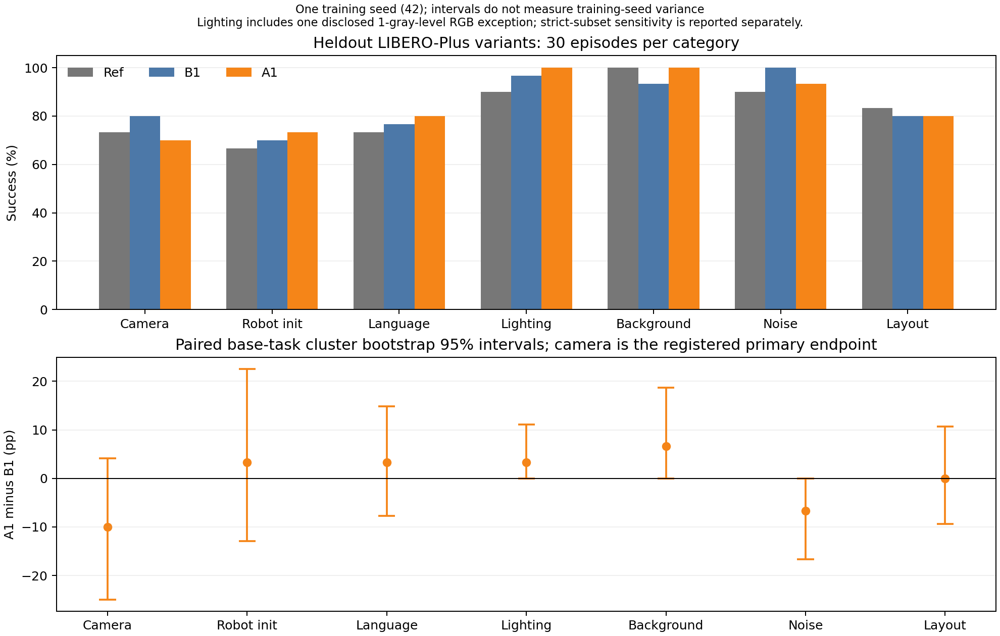
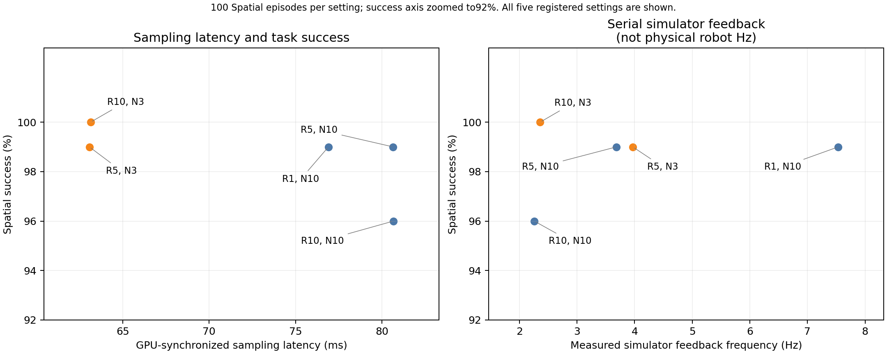

# π0.5 robustness and inference-efficiency study

A completed single-seed controlled study with a negative augmentation result. This repository contains the audited code and episode-level results. See [the Chinese report](REPORT.zh-CN.md) for methods, deviations, limitations and an accurate project description.

| Model | Clean LIBERO (400 episodes) | Heldout LIBERO-Plus variants (210 episodes) |
|---|---:|---:|
| Ref: official checkpoint | 96.00% | 82.38% |
| B1: default continued fine-tuning | 97.50% | 85.24% |
| A1: additional view/wrist augmentation | 97.25% | 85.24% |

The registered primary endpoint, camera robustness A1 minus B1, was −10 percentage points (task-cluster bootstrap 95% interval −25.00 to 4.17). Overall heldout gain was zero. The experiment does not demonstrate augmentation superiority. There is one disclosed initial lighting RGB exception; strict-subset sensitivity results are included. Forty base tasks are shared across diagnostic and heldout variants. One training seed does not estimate training-seed variance.

At R=5, reducing flow steps N=10→3 decreased median synchronized sampling latency by 21.8% (both 99/100 Spatial success). At N=10, R=5→1 increased measured serial simulator feedback frequency from 3.68 to 7.54 Hz (2.05×, both 99/100), with lower amortized action throughput. Simulator feedback frequency, action throughput and physical robot control frequency are distinct metrics.





## Inspect and recompute results

The public result verifier uses Python 3.10+ standard libraries only. It verifies the release manifest, all 2,330 episode records, success rates, all paired and category-level statistics, strict RGB sensitivity comparisons, and efficiency success comparisons:

```bash
python scripts/verify_public_results.py
```

Records in `results/episodes/*.jsonl.gz` contain actions, rewards, done signals, prompt, initial-state/render hashes, request seeds and timings. Only video references were relocated; scientific episode values were preserved. Original source-file SHA-256 hashes and the transformation are recorded in `results/episode_index.json` and `results/provenance.json`. Full videos, data and model weights are excluded. `results/training/` holds both 5,000-step logs and checkpoint manifests. Trained checkpoints remain on the original compute instance; no public model download is claimed.

`results/results.json` is the unchanged remote analysis output, so its internal status predates independent local acceptance. `evidence/original_machine_acceptance.json` records the later successful local audit; its pending visual-review flag is superseded by `evidence/final_manual_review_acceptance.json`. These are separate dated records, not silently rewritten historical evidence. Sampled video-review scope and notes are in `results/visual_review/review_index.json`.

## Code and reproduction

Pinned upstreams: openpi `215abfb217dbac7d5f1273282331b9b1866c0479`, LIBERO `f78abd68ee283de9f9be3c8f7e2a9ad60246e95c`, LIBERO-Plus `4976dc30028e805ff8094b55501d532c48fec182`. Training data `physical-intelligence/libero` revision `a4336d589d589045d1c56423ffdf3b88a0e19b1f`; Plus assets `Sylvest/LIBERO-plus` revision `dd2bd61b7d9a6fef1abc52d606e983b41886a149`.

`configs/` contains the original frozen training plan, diagnostic and heldout identities, analysis registration, inference reproducibility registration, runtime amendment and posthoc RGB integrity amendment. Original registration hashes remain unchanged. `evidence/upstream/manifest.json` records exact source URLs via repository/revision/file identities. Only Apache-licensed openpi text fixtures required by patch tests are bundled; other upstream sources/assets must be fetched from their own repositories.

Linux GPU execution used a Python 3.11.14/JAX 0.5.3 policy environment and separate Python 3.8.20 clean/Plus simulator environments, RTX 4090, EGL headless rendering. The training recipe is batch 16, 5,000 steps, seed 42, final step 4999, warmup 100, peak LR 1e−5, cosine decay to 1e−6, no EMA, action horizon 10. About 13.72% of parameters train, including non-LoRA vision parameters. Extra A1 augmentation is disabled at inference.

Operational scripts are preserved as research code. Start with `scripts/setup_probe.py` (isolated dependencies and official checkpoint), `scripts/setup_plus.py`, `scripts/fetch_hf_resources.py` (pinned inventories), `scripts/patch_openpi.py`, `scripts/patch_camera_augmentation.py`, `scripts/patch_training_audit.py`, `scripts/run_training.py`, and `scripts/run_evaluation.py`. Inspect each `--help` and the frozen configurations before executing. Training supervisors require fresh output directories, verified dataset manifests and bounded runtime. `--evaluator-script scripts/evaluate_v3.py --plus-split heldout` selects the final heldout protocol. Final paired analysis and plotting live in `scripts/analyze_final.py` and `scripts/plot_results_publication.py`.

Historical supervisors contain original instance paths and evidence dependencies. This package is not a one-command portable rerun: rebind filesystem paths, regenerate verified download/checkpoint manifests, and calibrate/persist complete XLA inference autotune caches for the target stack before new evaluations. Original bridge failure is preserved in the report; do not claim arbitrary-platform bitwise reproducibility. Original GPU autotune cache hashes are registered, but those architecture/runtime-specific binaries are not bundled here.

Offline protocol and source-patch tests:

```bash
python -m pip install -r requirements-test.txt
python -m unittest discover -s tests -v
```

NumPy is needed for numerical augmentation checks; Google CRC32C enables optional transport checksum tests. GPU training needs pinned upstream environment dependencies, not this CPU verification command. Figure regeneration additionally needs matplotlib/NumPy and relocated training-log paths. Existing figures were rendered from measured results and visually inspected.

## Scope and licensing

See [LICENSE](LICENSE), [NOTICE](NOTICE) and `third_party_notices/`. Model weights, simulator assets and datasets retain their original licenses/access conditions. No credentials, billing records or cloud-management integration are included. No additional cloud instance is provisioned and no power state is managed by the release process.

## Publication records

The dated acceptance/provenance records were produced before publication and retain their original `github_published: false` snapshot flags. These are historical audit records, not current repository status. Public source and release assets are available at [NanZ-HJKKK/pi05-robustness](https://github.com/NanZ-HJKKK/pi05-robustness).
